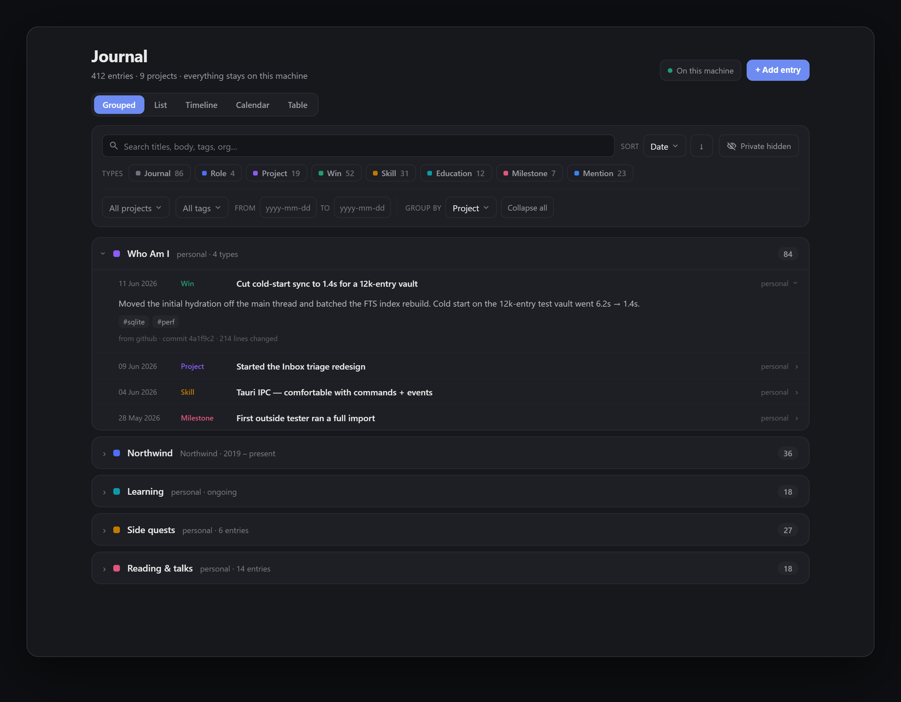

# Who Am I

A private, locally-owned record of one person — life and career on a single
timeline — that generates a resume and a personal website on demand. The
record is plain Markdown in a Git repo you hold; this app (a Tauri desktop
app) reads and writes those files but **does not own the data**.



## Why

- **Brutally accurate** — the raw truth goes in the record; polishing happens
  only when generating a resume or site.
  See [docs/who-am-i-brief.md](docs/who-am-i-brief.md).
- **My eyes only** — a set of files you hold, synced with plain Git. No
  server, no cloud DB, no auth.
- **Text is canonical** — the SQLite index is a throwaway cache, rebuilt from
  the Markdown and never synced. Delete it anytime; zero data loss.

## Quick start

Prerequisites: **Node 20+** with **pnpm**, **Rust** (stable), and Tauri's
platform deps — see
[tauri.app/start/prerequisites](https://tauri.app/start/prerequisites/).

```bash
pnpm install
pnpm tauri dev      # desktop app (pnpm tauri:wsl under WSL)
pnpm tauri build    # native bundle
```

`pnpm test` runs the core suite (vitest, node-backed platform); `pnpm check`
type-checks. `pnpm dev` / `pnpm build` run just the SvelteKit frontend.

## The record folder

A normal Git repo of Markdown (`profile.md`, `entries/*.md`) you choose at
runtime — default `~/whoamidocs`, outside this repo. An empty folder is
scaffolded on first open; the index lives in the OS app-data dir, never inside
the repo. Sync is explicit Git (pull --rebase / add / commit / push).

## Features

- **Journal** — every entry on one timeline: Grouped · Timeline · Calendar ·
  Table views, with type/project color coding and filters.
- **Import inbox** — pull history from **GitHub, Asana, Shortcut, Gmail
  (metadata-only), LinkedIn, a résumé, your own website, Claude Code, Warp,
  and NeuroSkill EEG sessions** into a review inbox. Nothing reaches the
  record without your explicit promote.
  [docs/import-pipeline.md](docs/import-pipeline.md).
- **Triage** — a deterministic prefilter plus optional LLM pass sorts
  candidates `keep | frivolous`; it never deletes or auto-rejects.
- **Feeds** — save a configured source as a re-runnable feed and *Refresh all*
  in a click; re-running only stages what's new.
- **Merge at promote** — combine N same-ticket candidates into one entry with
  full provenance, deterministically.
  [docs/merge-at-promote-spec.md](docs/merge-at-promote-spec.md).
- **Reduce & Wins** _(optional LLM)_ — roll a noisy inbox into entry drafts,
  or draft résumé-grade wins from picked entries (evidence-gated; nothing
  saved until you accept).
- **Generators** — resume (Markdown) and standalone site (HTML) from the
  record; private entries excluded, wins nested under their role/project.
- **Secrets in the OS keyring** — provider tokens and the Anthropic key never
  live in the record, settings, or the app config. All fetched content is
  data, never instructions.

## Stack

[Tauri 2](https://v2.tauri.app/) (Rust shell) ·
[SvelteKit](https://svelte.dev/) (Svelte 5 runes, TypeScript, SPA) ·
framework-agnostic TypeScript core behind a `Platform` seam (fully
unit-testable off-device) · SQLite index · Markdown + Git on disk.
Architecture deep-dive: [docs/architecture.md](docs/architecture.md).

## Out of scope

By design: no custom sync engine or server (sync is plain Git), the index is
never authoritative or committed, no auto-push, no auto-resolved conflicts, no
auto-promote (every entry is a human decision), and no "polishing" of the raw
record — polishing is an output-stage concern only.
