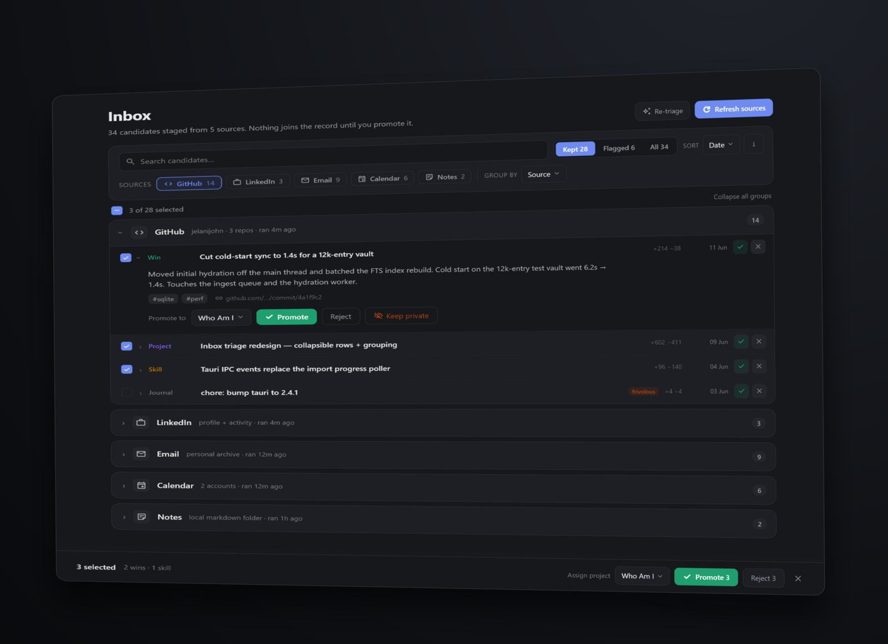

# Import & the AI pipeline

Beyond hand-written journal entries, the app can pull history in from external
sources and help you shape it — but **nothing reaches the record without your
explicit promote.**

## Ingest (`src/lib/core/ingest/`)

Adapters for GitHub, Asana, Shortcut, Gmail, LinkedIn, an imported résumé,
your own personal website, your Claude Code and Warp AI history, and your
NeuroSkill EEG focus sessions map provider data into normalized items, landing
them as *candidates in a review inbox* (never the record). Mappers are pure and
fixture-tested; the layer never touches the record, secrets, or the index
directly.

### GitHub

The GitHub adapter imports either the issues & PRs you authored or, per run, a
repo's commits you authored (change-size counts and your message — never the
diff); commits whose PR you already imported are skipped by default (the PR
lookup rides the same query — no extra calls).

### Shortcut

GitHub items that mention a Shortcut ticket (`sc-12345`, pattern configurable)
are always tagged with it; with a Shortcut token saved, imports — and an inbox
backfill button — also enrich them with that story's metadata (name, state,
epic…), one fetch per distinct ticket, description off by default.

With that same token, Shortcut is also a source of its own: a windowed import
of the stories you *follow* (following accretes from owning, requesting, or
commenting and survives reassignment, so handed-off work still comes back;
archived stories included), each carrying its bounded description and your
provable roles.

At promote time, a GitHub candidate tagged with a story already promoted into
the record gets that entry prefilled as its parent — a visible suggestion you
can clear.

### Merge at promote

The inbox can group by ticket (Shortcut id, with a marked title-similarity
fallback) and **merge** N selected GitHub candidates into ONE entry at the
promote gate: a ledger of every commit/PR plus their deduplicated messages,
carrying every constituent's provenance so re-imports skip them all.
Deterministic, preview first, and never applied to already-promoted entries.
See [merge-at-promote-spec.md](merge-at-promote-spec.md).

### Gmail

The Gmail importer is metadata-only (subjects & snippets, never bodies) and
driven by a Gmail search query you can type by hand or have the LLM draft from
a plain-English description ("unread from my manager this week") — the
suggestion only fills the editable query field; nothing is fetched until you
run the import.

Gmail auth is a one-time **Connect Gmail** consent flow (desktop loopback +
PKCE) against your own Google *Desktop* OAuth client — create one in Google
Cloud (enable the Gmail API, consent screen "In production", Desktop-app
credentials; the in-app help walks through it), paste its ID + secret once, and
the resulting read-only grant lives in the OS keyring with access tokens
refreshed automatically. The app ships no shared Google credentials.

### Website

The website importer fetches only the pages you enter (and a sitemap you point
at) — it is not a crawler — and treats the polished prose as a prompt to write
the rawer truth underneath.

### NeuroSkill

The NeuroSkill importer reads past EEG sessions from another app's local
SQLite (read-only, `eeg_timeseries` + `labels` only) into one dated journal
candidate each — focus/engagement means and a peak-focus window — always
private and prefilter-only, with short calibration blips flagged frivolous.
See [whoami-neuroskill-ingest-spec.md](whoami-neuroskill-ingest-spec.md).

### Staging rules

An item that arrives without a real date is staged as *needs-date*: you set
its date in the inbox before promoting — the app never silently defaults it to
today (brutal accuracy). Candidates stage **private-by-default**; a lock
toggle on each inbox row (plus a bulk Private/Public action on the selection)
flips what an item will enter the record as before you promote — the flag is
written onto the staged file, so the choice persists and a merge stays private
while any constituent is.

## Triage (`src/lib/core/triage/`)

A deterministic prefilter that always runs, plus an optional LLM pass,
annotates each candidate with a `keep | frivolous` sort signal. It only sorts:
never deletes, hides, or auto-rejects, and the signal is stripped on promote.

## Feeds (`src/lib/core/feeds.ts`)

Save a configured source (GitHub, Asana, Shortcut, Gmail, website, Claude
Code, Warp, or NeuroSkill) as a re-runnable *feed*, then **Refresh all** to
re-pull every one in a click. Feeds are machine-local (localStorage, never the
record — tokens stay in the keyring), and re-running only stages what's new.
Inbox-only like every import; nothing is auto-promoted.

## Reduce (`src/lib/core/reduce/`)

An optional LLM map/reduce that rolls a noisy inbox up into clean entry drafts
for you to review.

## Wins (`src/lib/core/wins/`)

Pick a set of journal entries and have the LLM draft résumé-grade
accomplishments from them. One synthesis call; every draft must cite the
entries it came from (ungrounded ones are dropped), and nothing is saved until
you accept. Each accepted win becomes its own `type: win` entry that the
résumé and site nest under its role or project. Wins default public — the one
deliberate exception to private-by-default, because they're curated for output
and have just passed your review.

## LLM seam (`src/lib/core/llm/`)

AI passes run through a provider abstraction: **Ollama** locally or
**Anthropic** (key in the OS keyring, never in the record or app config). With
no provider configured the app says so instead of failing; the AI features are
entirely opt-in.

## Security stance

Text fetched from providers is treated as *data, never instructions* — stored
verbatim, and any LLM pass wraps it in fenced data blocks with an explicit
do-not-follow guard, so an imported issue title can't hijack the model.
